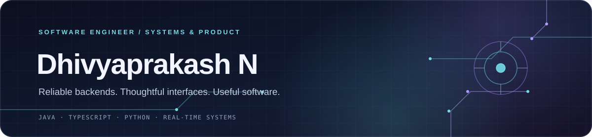

  

  <a href="https://the-paradox-room.cookie-song-938.workers.dev/"><strong>PLAY THE PARADOX ROOM</strong></a>
  &nbsp;·&nbsp;
  <a href="https://www.linkedin.com/in/dhivyaprakash/">LinkedIn</a>

## About

I’m a software engineer with nearly four years in IT. I build web applications and services with attention to the details that make them dependable: clear APIs, safe state changes, useful tests, and interfaces people can understand.

My work spans real-time multiplayer systems, transactional booking workflows, and data exploration.

## Selected work

### The Paradox Room · Real-time multiplayer

A browser mystery where each witness explores a different version of the room. Play solo with three rule-based AI witnesses or invite people to a private match.

- **Built with:** TypeScript, Cloudflare Workers, Durable Objects, WebSockets
- **Engineering focus:** Server-owned room state, private evidence projections, reconnect-safe sessions, and full-round multiplayer tests
- [Play the game](https://the-paradox-room.cookie-song-938.workers.dev/) · [Architecture and security](https://github.com/Dhivyaprakash-hub/the-paradox-room/blob/main/docs/architecture.md) · [Source](https://github.com/Dhivyaprakash-hub/the-paradox-room)

### Careway · Appointment booking

A booking application using fictional listings. The Spring service locks the doctor record during booking, while a database constraint protects a time slot from duplicate reservations. A concurrency test races two bookings for the same slot.

- **Built with:** Java, Spring Boot, React, H2
- [Run locally](https://github.com/Dhivyaprakash-hub/Hospital-application#run-locally) · [Booking service](https://github.com/Dhivyaprakash-hub/Hospital-application/blob/main/backend/src/main/java/com/dhivya/consultation/AppointmentService.java) · [Concurrency test](https://github.com/Dhivyaprakash-hub/Hospital-application/blob/main/backend/src/test/java/com/dhivya/consultation/AppointmentConcurrencyTest.java)

### AeroPulse · Applied data analysis

A retrospective comparison of two flight-delay models across 2.82 million held-out flights. The analysis reports a modest improvement and documents limitations around aircraft assignment data.

- **Built with:** Python, pandas, scikit-learn
- [Study and reproduction steps](https://github.com/Dhivyaprakash-hub/AeroPulse) · [Model card](https://github.com/Dhivyaprakash-hub/AeroPulse/blob/main/MODEL_CARD.md)

### Climate Atlas · Data exploration

A responsive dashboard for exploring a supplied climate-temperature snapshot with monthly heatmaps, country comparisons, search, and CSV export. The README documents the dataset’s source and limitations.

- **Built with:** HTML, CSS, JavaScript, CSV
- [Explore the project](https://github.com/Dhivyaprakash-hub/Climatic_Visualization)

## Technical focus

**Backend:** Java · Spring Boot · REST APIs · PostgreSQL · Cloudflare Workers  
**Frontend:** TypeScript · JavaScript · React · HTML · CSS  
**Data:** Python · pandas · scikit-learn  
**Engineering:** concurrency · real-time state · API security · integration testing · observability

## More work

- [Car Rental System API](https://github.com/Dhivyaprakash-hub/Car-Rental-System-API) · Spring Boot and PostgreSQL API
- [Wellnest](https://github.com/Dhivyaprakash-hub/demo-screen) · Searchable product catalog with comparison and saved items · [Demo](https://dhivyaprakash-hub.github.io/demo-screen/)
- [Taskflow](https://github.com/Dhivyaprakash-hub/Angular-POC) · Angular task board with browser-local workspaces · [Demo](https://dhivyaprakash-hub.github.io/Angular-POC/)
- [MindMate](https://github.com/Dhivyaprakash-hub/MindMate) · Browser journal with local storage, export, and deletion controls

---

Good software is clear in the interface, careful with data, and reliable when the important request arrives.