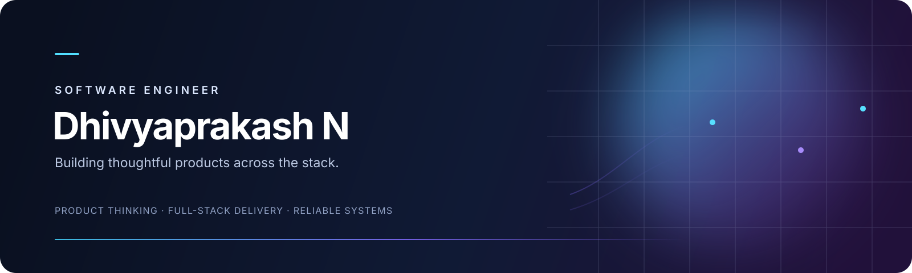

### Software Engineer · Full-stack products · Backend systems

I turn ideas into usable software—from interactive web experiences to documented APIs. I care about clear interfaces, dependable behavior, and the details that make a project understandable to the next person.

[Explore my projects](#selected-work) · [See the live game](https://the-paradox-room.cookie-song-938.workers.dev/) · [Browse repositories](https://github.com/Dhivyaprakash-hub?tab=repositories)

---

## Selected work

| Project | What it is | Stack |
| --- | --- | --- |
| **[THE PARADOX ROOM](https://github.com/Dhivyaprakash-hub/the-paradox-room)** · [Play](https://the-paradox-room.cookie-song-938.workers.dev/) | A live multiplayer mystery where players investigate different versions of one room and piece together a shared timeline. | TypeScript · Cloudflare Workers · Durable Objects |
| **[Careway](https://github.com/Dhivyaprakash-hub/Hospital-application)** | A healthcare operations experience rebuilt around clear workflows, a modern interface, and a Spring Boot API. | React · TypeScript · Spring Boot |
| **[Wellnest](https://github.com/Dhivyaprakash-hub/demo-screen)** | A clinical product catalog interface with searchable sample data and careful health-content boundaries. | React · TypeScript · Vite |
| **[Taskflow](https://github.com/Dhivyaprakash-hub/Angular-POC)** | A focused task-management application with a responsive Angular interface and persistent workspaces. | Angular · TypeScript |
| **[FRAME](https://github.com/Dhivyaprakash-hub/workshop-graphql-netflix)** | A cinematic discovery experience for exploring films and curated collections. | React · TypeScript |
| **[Climate Atlas](https://github.com/Dhivyaprakash-hub/Climatic_Visualization)** | An interactive look at climate patterns, designed to make country-level comparisons easier to explore. | JavaScript · Data visualization |
| **[MindMate](https://github.com/Dhivyaprakash-hub/MindMate)** | A private, browser-based journaling and reflection space. Entries stay on the device. | TypeScript · Web APIs |
| **[Java Trail](https://github.com/Dhivyaprakash-hub/javatraining)** | A hands-on learning path through Java fundamentals, examples, and small exercises. | Java |

<strong>More builds</strong>

 

- [Car Rental API](https://github.com/Dhivyaprakash-hub/Car-Rental-System-API) — a documented Spring Boot REST API for vehicle availability and rental workflows.
- [Feedback Hub](https://github.com/Dhivyaprakash-hub/Feedback-Management-System) — a full-stack feedback collection and review application.
- [Restaurant Operations](https://github.com/Dhivyaprakash-hub/N_Dhivyaprakash_C3_Project) — a Spring Boot service for menus, opening hours, availability, and order totals.
- [Baymax](https://github.com/Dhivyaprakash-hub/mini_baymax) — an early Python chatbot experiment.

> The refreshed applications above are published on their default branches, so you can open each repository to see its current version.

## Toolkit

**Languages** · Java · TypeScript · JavaScript · Python  
**Frontend** · React · Angular · HTML · CSS  
**Backend** · Spring Boot · REST APIs · GraphQL  
**Platforms** · Cloudflare Workers · Git · GitHub Actions

## How I work

- Design the complete flow, then make the interface explain itself.
- Keep APIs documented and predictable, with validation at the boundary.
- Treat privacy, accessibility, and responsive behavior as product requirements.
- Leave projects easier to run, understand, and extend than I found them.

---

**Building thoughtful software, one useful release at a time.**

